# Binchitects — two sites, one repository

The public sites for **Binchitects**, in English and Persian:

- **[binchitects.com](https://binchitects.com)** — the studio: a one-page
  statement about community, open-source development and the long run.
- **[argus.binchitects.com](https://argus.binchitects.com)** — the product:
  ARGUS, Argus Arena, Code Arena and the Argus code index.

Both front ends are React + TypeScript + Vite, built as static files and served
by unprivileged nginx images. Persian lives under `/fa` and mirrors the layout
right-to-left. Argus adds a .NET 10 minimal API behind its site.
Three images, built from this repository, deployed together.

<p align="center">
  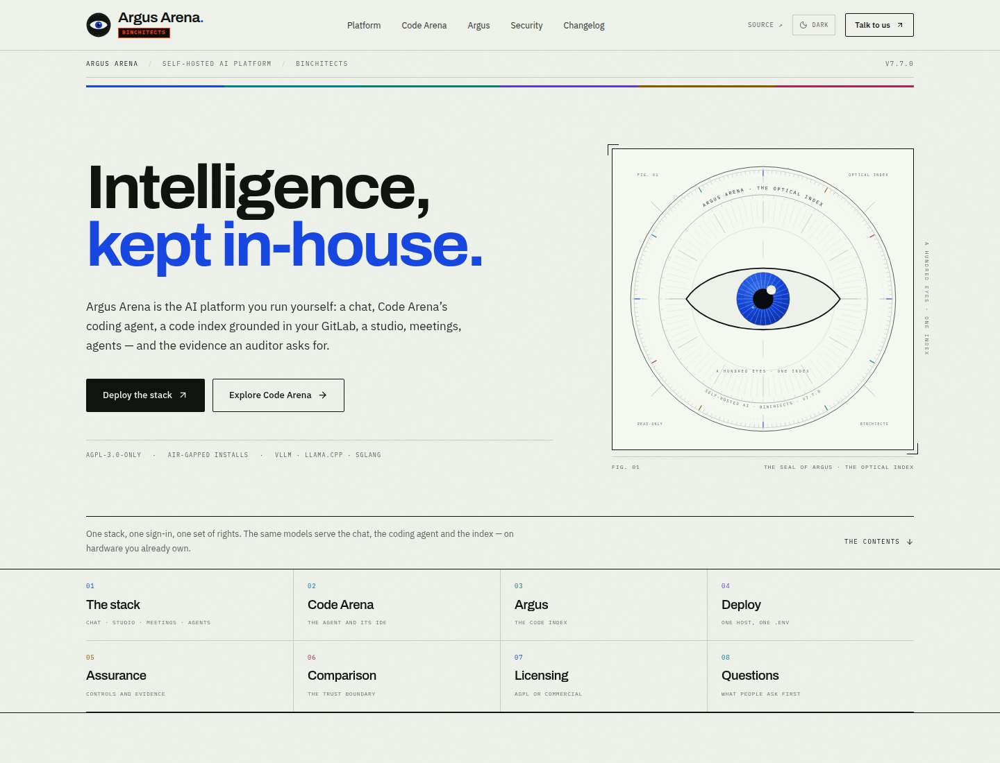
</p>

<p align="center">
  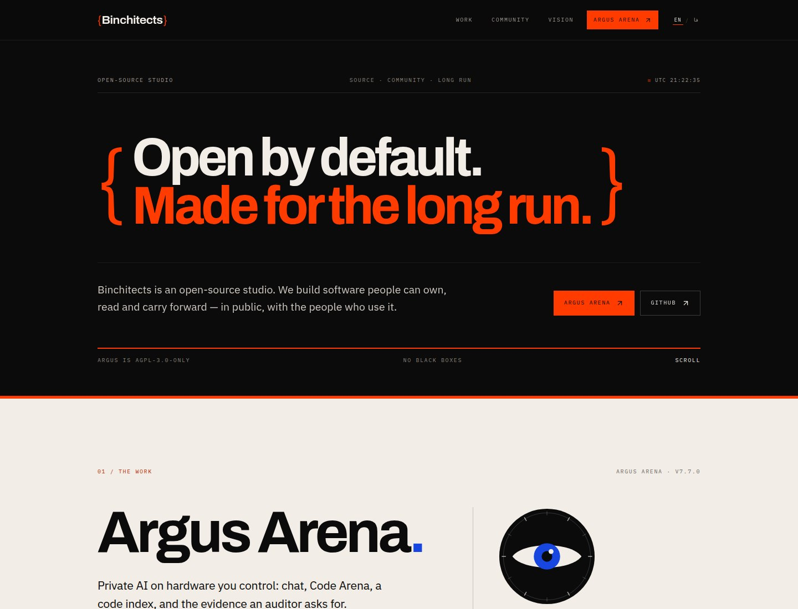
</p>

```
  browser ──► traefik :443 ──► binchitects (nginx)  ──► static studio page
     │            │
     │            └──────────► web (nginx) ──────────► api (.NET 10)
     │                           │  /api proxy          │
     │                           └──────────────────────┘
     │                                                     ▼
     └── :80 redirects to :443                    /data/contact-requests.jsonl
```

The sites are designed to run the way the product does: on your own hardware.
They have no third-party runtime code — no analytics, no external font host, no
database server — and they run the same with or without a CDN in front. The API has **no NuGet packages**, so it builds
without a package feed; the two web images still need npm at build time. Once
built, the stack runs on an air-gapped network.

---

## Quick start

```bash
cp .env.example .env
# put the certificate and key at the paths named in .env
docker compose up -d --build      # or `docker compose up --build` to watch it
```

Traefik serves both domains over the TLS certificate you supply. Open
<https://argus.binchitects.com> and <https://binchitects.com>. For a local trial
with a self-signed certificate on `.localhost`, see the short recipe in
[`docs/DEPLOYMENT.md`](docs/DEPLOYMENT.md#4-a-local-trial).

```bash
docker compose logs -f edge     # the edge
docker compose logs -f          # all four containers
docker compose down             # stop
docker compose down -v          # stop and remove the contact-request volume
```

## Screens

| | |
|---|---|
| 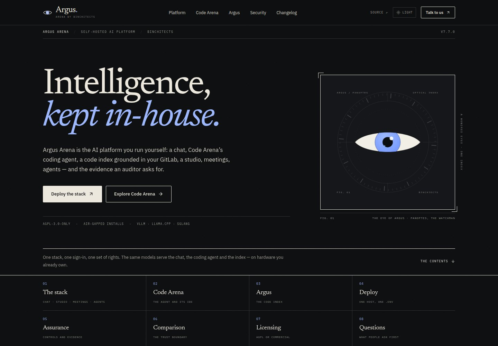 | 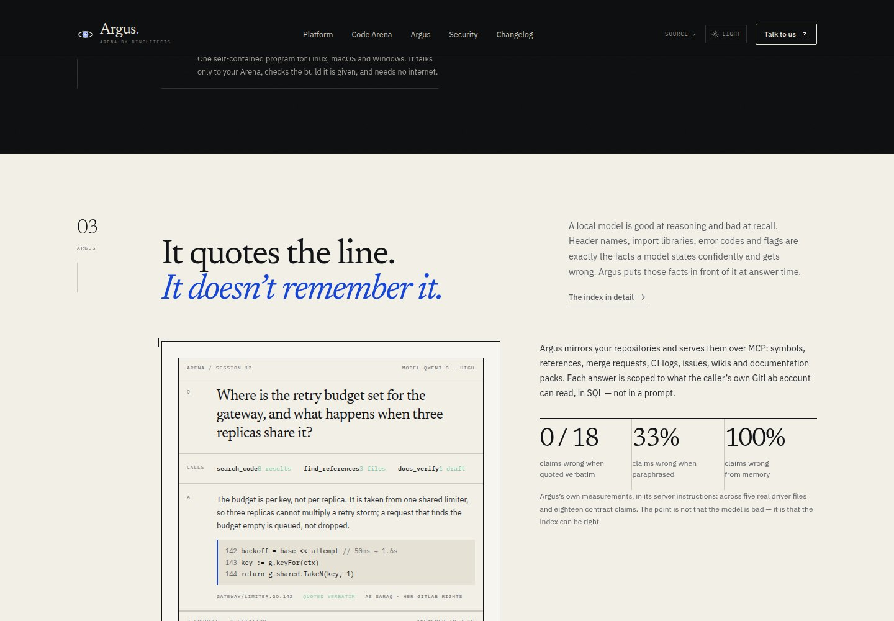 |
| 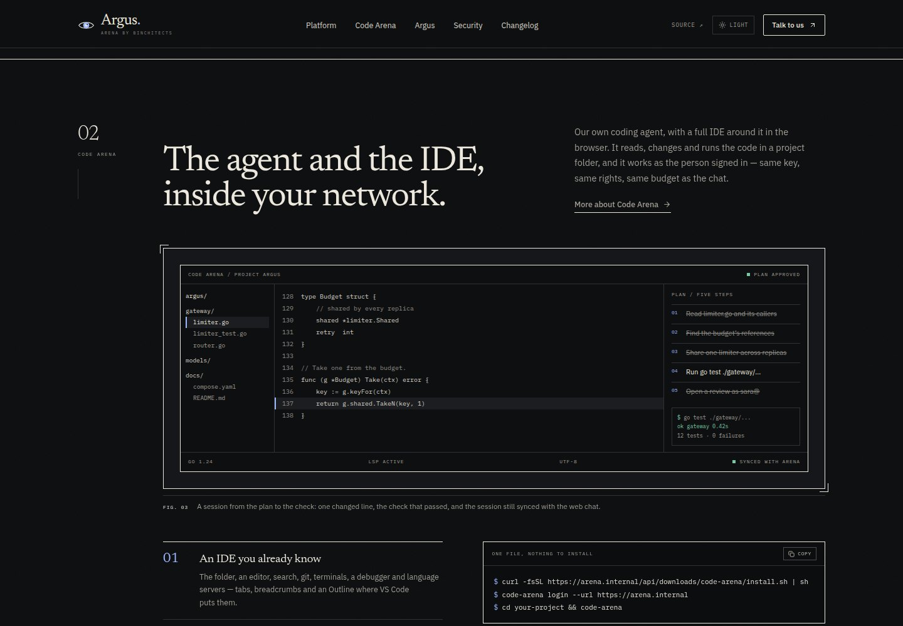 | 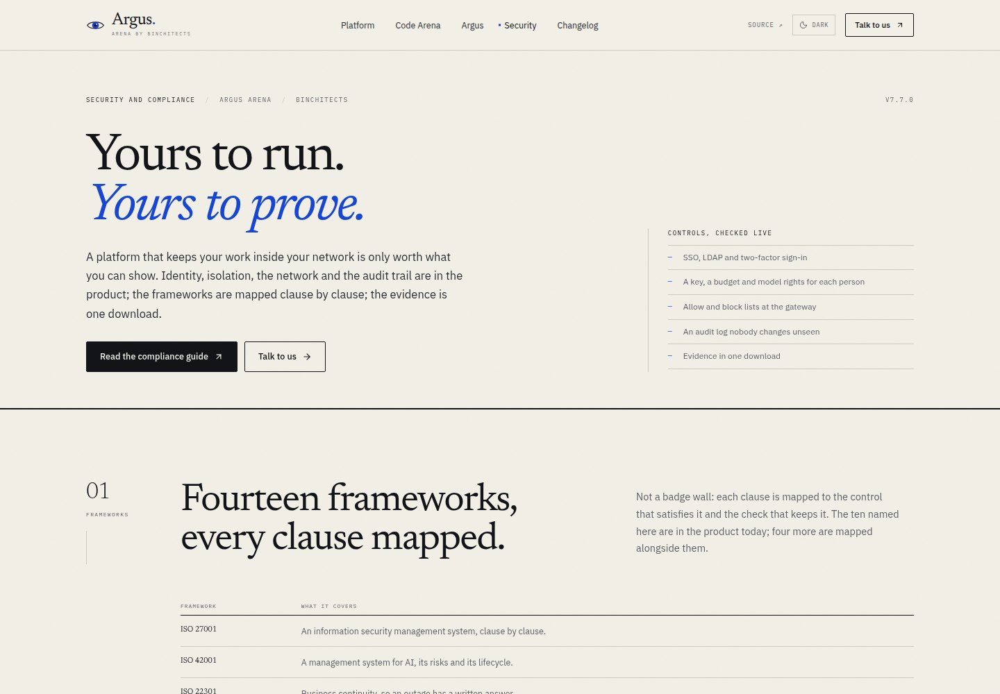 |
| 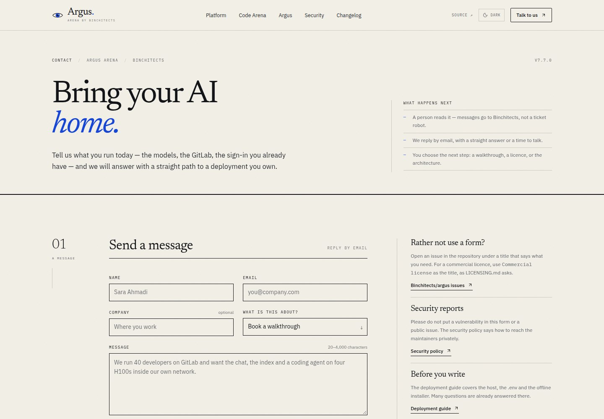 | 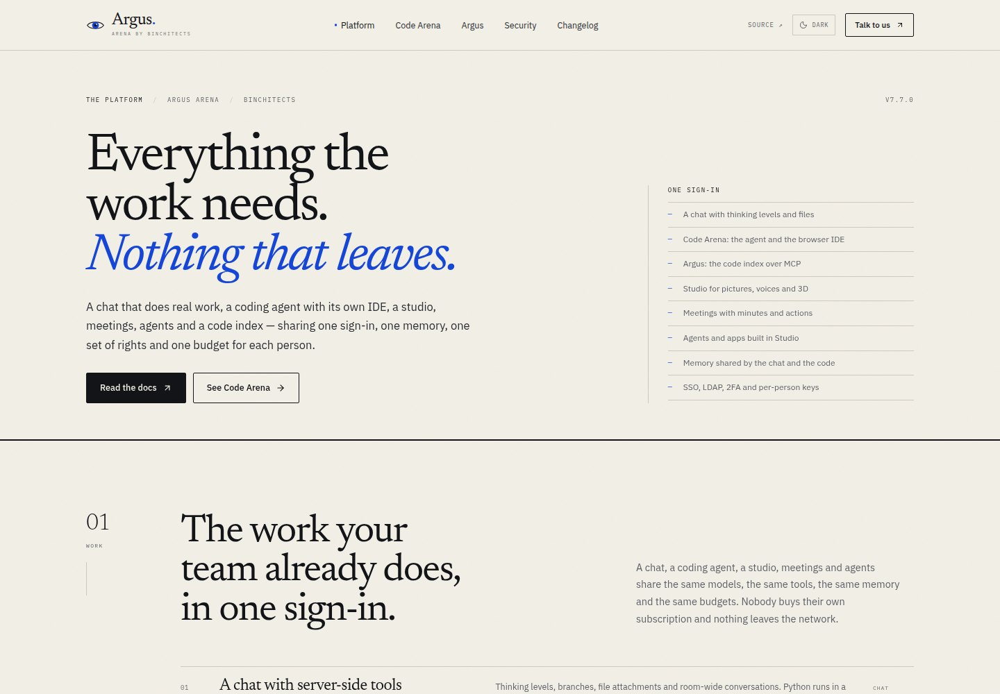 |
| 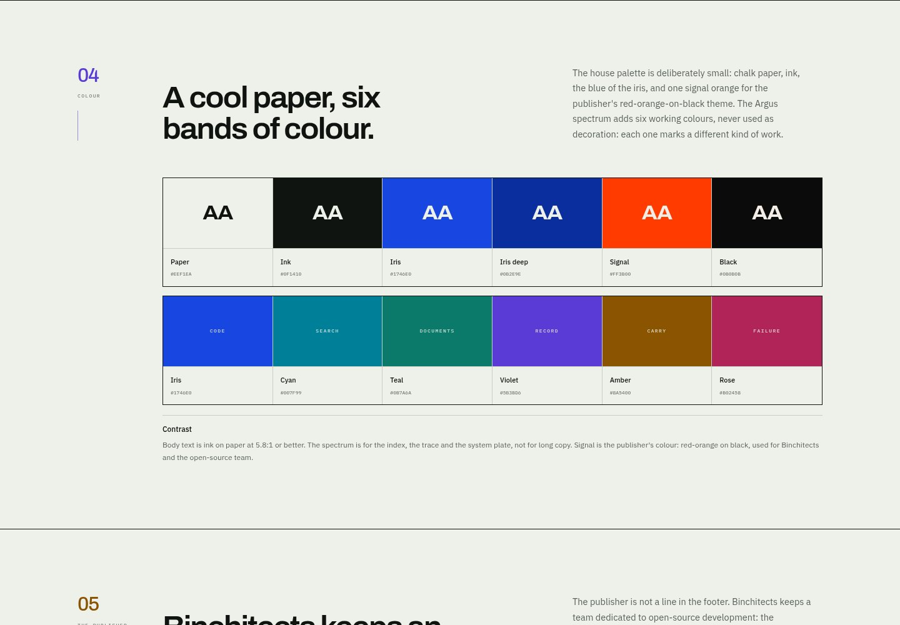 | 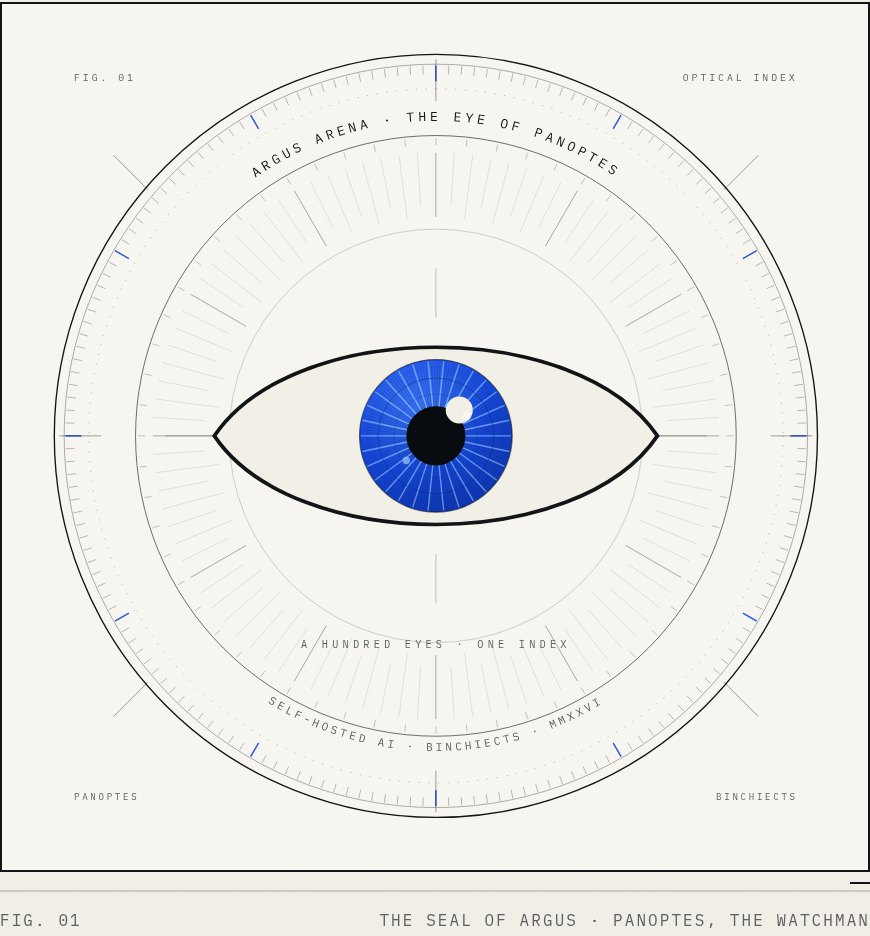 |
|  | 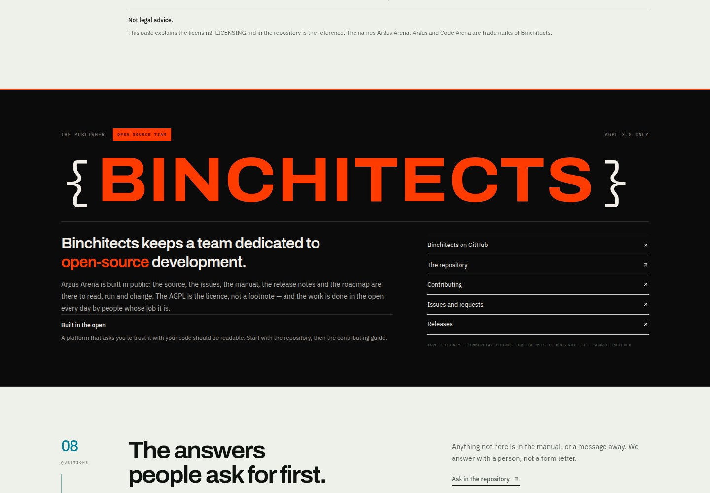 |
| 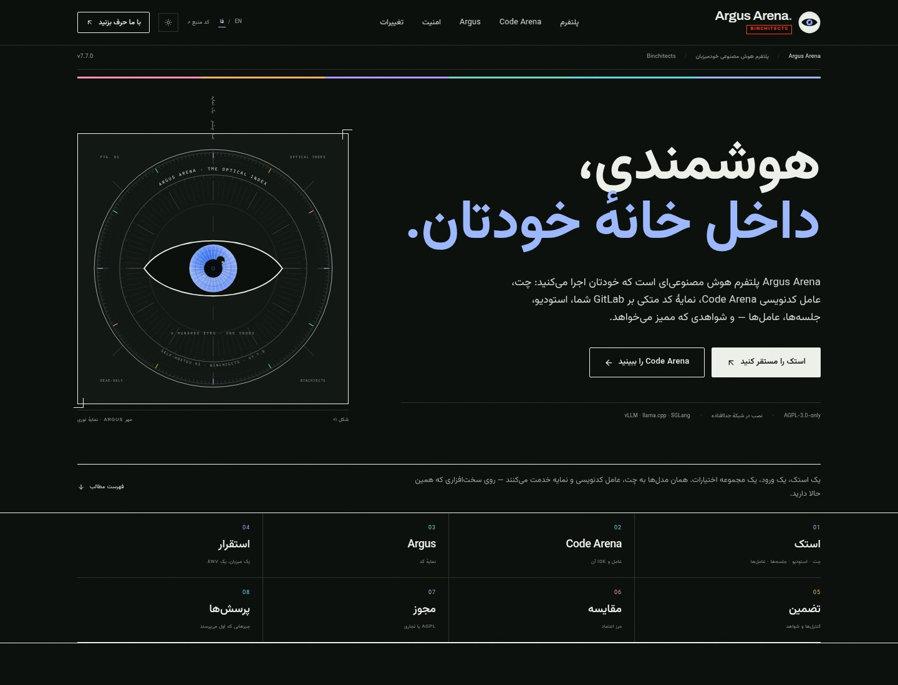 | 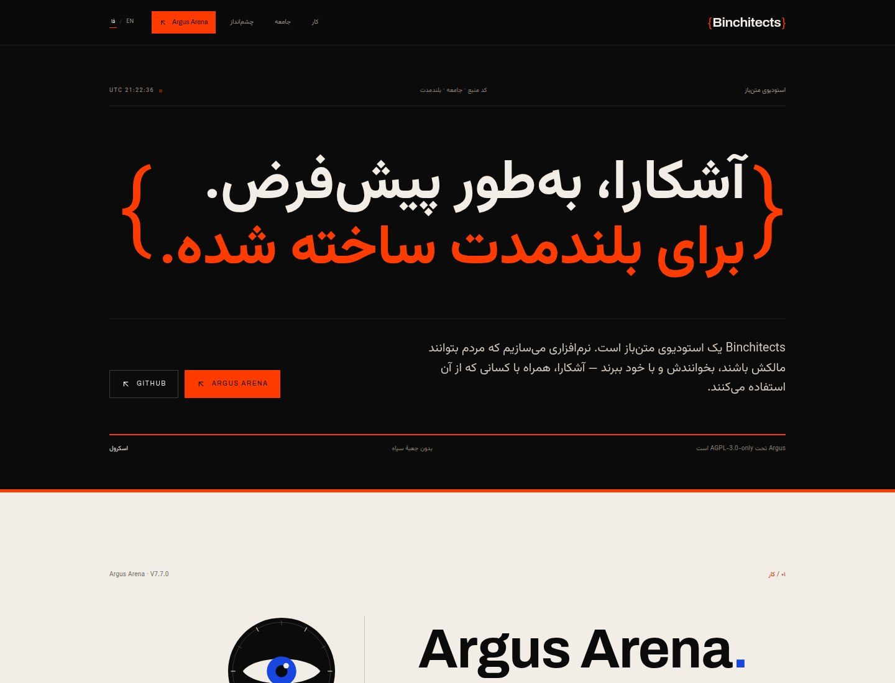 |

### The publisher


Binchitects keeps a team dedicated to open-source development. The Argus home page
gives the publisher a full band — the name between two code braces, the statement,
and the way into the repository, the contributing guide, the issues and the
releases. The same story is a chapter on `/brand`; the masthead and footer carry
the publisher's name in bold. The publisher's own site takes the same voice and
gives it a page: [binchitects.com](https://binchitects.com).

## Production: both domains

1. **DNS** — `A` (and `AAAA`, if you have it) records for
   `argus.binchitects.com` and `binchitects.com` pointing at the host. Ports 80
   and 443 reachable.
2. **Certificate** — one certificate and key covering both names as SANs, at
   `deploy/tls/fullchain.pem` and `deploy/tls/privkey.pem` (or point
   `TLS_CERT_FILE` / `TLS_KEY_FILE` elsewhere).
3. **Environment** — copy `.env.example` to `.env` and set:

   ```dotenv
   ARGUS_DOMAIN=argus.binchitects.com
   BINCHIECTS_DOMAIN=binchitects.com
   TLS_CERT_FILE=./deploy/tls/fullchain.pem
   TLS_KEY_FILE=./deploy/tls/privkey.pem
   IP_HASH_SALT=<openssl rand -hex 32>
   ADMIN_TOKEN=<openssl rand -hex 32>          # optional, enables the CSV export
   ```

4. **Up**:

   ```bash
   docker compose up -d --build
   ```

   Traefik terminates TLS with that certificate for both hostnames, routes each
   to its image, and redirects HTTP to HTTPS. The API is never published; only
   80/443 are. Behind Cloudflare, `CF-Ray` requests are served directly over the
   proxied HTTP hop, so Flexible or a tunnel on port 80 does not loop; Full
   (strict) is still the recommended mode. Certificate renewal is yours: replace
   the files and `docker compose restart edge`.
   See [`docs/DEPLOYMENT.md`](docs/DEPLOYMENT.md) for the certificate check,
   local trial, backups and hardening, and [`docs/SEO.md`](docs/SEO.md) for the
   Search Console, sitemap and content checklist.

## Local development

Prerequisites: .NET 10 SDK, Node 22+, Docker (for images only).

```bash
# terminal 1 — the API
dotnet run --project src/api/Argus.Site.Api.csproj --urls http://127.0.0.1:5080

# terminal 2 — the Argus app with hot reload
cd src/web
npm ci
npm run dev            # http://127.0.0.1:5173, proxies /api to :5080

# terminal 3 — the studio site
cd src/binchitects
npm ci
npm run dev            # http://127.0.0.1:5174
```

`make dev-api`, `make dev-web` and `make dev-bin` do the same from the root.

The API stores contact requests under `src/api/data/` in development and at
`/data` in the container. Change it with `Site__DataDirectory`.

## Tests

```bash
cd src/web && npm test          # 19 unit/component tests (Vitest + Testing Library)
cd src/binchitects && npm test  # 5 tests for the studio page
dotnet build                    # the API builds with zero packages
tests/smoke/api.sh              # against a running stack (API endpoints)
tests/smoke/web.sh              # against a running stack (static routes + proxy)
tests/smoke/binchitects.sh      # against a running stack (the studio site)
make test                       # all type-checks, tests and builds
make smoke                      # all three smoke scripts, after `docker compose up -d`
```

The smoke scripts use `curl` only and can be pointed anywhere with `BASE_URL`.
For the local self-signed stack, add `CURL_OPTS=-k`:

```bash
CURL_OPTS=-k make smoke
```

Or point one script at the edge directly:

```bash
BASE_URL=https://argus.localhost:9443 \
CURL_OPTS="-k --resolve argus.localhost:9443:127.0.0.1" \
  tests/smoke/web.sh
```

## Configuration

| Variable | Default | What it does |
|---|---|---|
| `ARGUS_DOMAIN` | `argus.binchitects.com` | Host Traefik routes to Argus |
| `BINCHIECTS_DOMAIN` | `binchitects.com` | Host Traefik routes to the studio |
| `TLS_CERT_FILE` | `./deploy/tls/fullchain.pem` | Certificate covering both names |
| `TLS_KEY_FILE` | `./deploy/tls/privkey.pem` | Its private key |
| `HTTP_PORT` | `80` | Traefik HTTP entrypoint on the host |
| `HTTPS_PORT` | `443` | Traefik HTTPS entrypoint on the host |
| `DOCKER_SOCKET` | `/var/run/docker.sock` | Rootless Docker uses a user socket |
| `IP_HASH_SALT` | empty | Salt for the stored hash of a request's address |
| `ADMIN_TOKEN` | empty | Enables `GET /api/admin/leads`; empty = disabled (404) |
| `CONTACT_WEBHOOK_URL` | empty | Optional Slack/Teams/CRM webhook for each enquiry |
| `GITHUB_TOKEN` | empty | Lifts GitHub's anonymous rate limit on the changelog |
| `CONTACT_PERMIT_LIMIT` | `5` | Contact requests per address per window |
| `CONTACT_WINDOW_MINUTES` | `10` | Length of that window |
| `IMAGE_TAG` | `local` | Tag for the three built images |

All settings are standard ASP.NET configuration, so anything under `Site:` can
also be set with `Site__Name=value` (for example `Site__ContactPermitLimit=3`).

## API

| Method | Path | Notes |
|---|---|---|
| `GET` | `/healthz` | Liveness only; no detail |
| `GET` | `/api/health` | JSON: status, version, per-check health |
| `POST` | `/api/contact` | Validate, store, optionally forward; `201`, `400`, `429` |
| `GET` | `/api/releases` | Cached GitHub releases, built-in fallback |
| `GET` | `/api/admin/leads?limit=200` | CSV; needs `X-Admin-Token`; disabled unless configured |

Contact requests are appended as one JSON object per line to
`/data/contact-requests.jsonl` (durable append, file locked per write). Addresses
are stored only as a truncated SHA-256 hash. One damaged line never hides the
others.

Back up the volume:

```bash
docker compose exec -T api cat /data/contact-requests.jsonl > contact-requests-$(date +%F).jsonl
# or
docker run --rm -v argus-site_site-data:/data -v "$PWD":/backup alpine \
  tar -czf /backup/site-data-$(date +%F).tar.gz -C /data .
```

## Repository

```
src/
  api/                 .NET 10 minimal API (no packages)
    Configuration/     SiteOptions, bound from the "Site" section
    Data/              the append-only contact store
    Features/          contact, releases, admin, health endpoints
    Releases/          GitHub feed with cache and fallback
    Dockerfile
  web/                 Argus — React 19 + TypeScript + Vite
    src/components/    layout, UI, brand mark and seal, product plates
    src/pages/         home, platform, code arena, argus, security,
                       changelog, contact, privacy, brand, 404
    src/lib/           content, SEO, helpers
    public/brand/      the mark and seal as downloadable SVG
    scripts/           route-meta prerender, sitemap, robots
    Dockerfile, nginx.conf
  binchitects/         the studio — React 19 + TypeScript + Vite, one page
    src/components/    wordmark, brace mark, the long horizon, UTC clock
    src/lib/site.ts    the links between the two sites and GitHub
    public/            favicon, app icons, social card, sitemap, robots
    Dockerfile, nginx.conf
tests/smoke/           curl checks for all three services
deploy/traefik/        the shared TLS certificate configuration
deploy/tls/            your certificate and key (gitignored)
docker-compose.yml     Traefik, both sites and the API
docs/DEPLOYMENT.md     DNS, TLS, local trial, backups, updates, hardening
docs/SEO.md            indexing, hreflang, structured data, content and links
docs/PERFORMANCE.md    payload, caching, Cloudflare rules, measured lab scores
docs/FONTS.md          subset fonts, variable ranges, licenses, regeneration
```

## Design

The site is set as printed matter for a private machine: cool chalk paper, ink
rules, numbered chapters, marginal notes and figure captions. Archivo carries
the claims in a tight, heavy grotesque; IBM Plex Sans and Mono carry the record.
There are no gradients, glows or glass in the interface.

The identity is deliberately two-sided. **Argus** is the colourful half: a
six-band spectrum (iris, cyan, teal, violet, amber, rose) used as working
notation in the index, the trace and the system plate. **Binchitects** is the
publisher half: red-orange on black, stamped into the page.

The identity is drawn, not traced. The **mark** is a roundel — an ink disc, a
paper eye, one blue iris and a dial whose six major ticks carry the spectrum —
so it holds at 16px and at two metres. The **seal** is the site's large
illustration: a 180-tick dial with its twelve majors in spectrum, a lens
diaphragm, and an iris cut in 150 radial lines. The favicon, app icons and
social image are generated from the mark and seal.

Product moments are printed rather than screenshotted: a radial index chart of
the Argus tools, a system-section schematic of the stack, a proof sheet from
Code Arena's IDE, and the agent's trace — each of them colour-coded by the
spectrum rather than tinted a single blue.

Every page is bilingual: English at the root, Persian under `/fa`. The build
writes a shell for each language with its own title, description, canonical URL,
`hreflang` alternates and `lang`/`dir`, and the sitemap lists both. A language
switch in the masthead keeps the reader on the same page.

## The studio site

`binchitects.com` is one page, and deliberately so. It is set in black and
red-orange: the statement held between two oversized braces, one paper spread
for Argus, three numbered ways into the community, a long-horizon figure for
the vision, and one orange band to close. The page is prerendered to HTML at
build time; a live UTC clock in the dateline is the only moving part besides the
page entrance.

There are no cards, gradients or glass. The page is Archivo, IBM Plex and
Vazirmatn, rules and numbers, and it links to the product
(`argus.binchitects.com`), the source, the issues and the contributing guide.
Everything is a static build; no API and no external requests. It is bilingual
too: English at `/`, Persian at `/fa`, each with its own prerendered HTML and
metadata.

## Performance

Both sites are prerendered, route-split and self-hosted, with no third-party
script on the page. The compiled stylesheet is inlined during prerender, so no
CSS request blocks the first paint. Page copy is split by route as well as by
language. The two prefetched font faces are subset to the glyphs the sites use,
and HTML carries a five-minute shared-cache TTL so an edge can answer without
going back to the origin.

Lighthouse 12, mobile, simulated slow 4G, production images:

| Page | Performance | Accessibility | SEO | LCP | Transfer |
| --- | ---: | ---: | ---: | ---: | ---: |
| Argus, English | 98 | 100 | 100 | 2.2 s | 272 KiB |
| Argus, Persian | 98 | 100 | 100 | 2.4 s | 284 KiB |
| Studio, English | 100 | 100 | 100 | 1.7 s | 182 KiB |
| Studio, Persian | 99 | 100 | 100 | 1.8 s | 191 KiB |

These are lab numbers on one host, not field data. The first request after a
deploy still pays the origin round trip; after that Cloudflare can serve the
HTML from cache. [`docs/PERFORMANCE.md`](docs/PERFORMANCE.md) has the exact
headers, the Cache Rule, the measurement commands and the remaining payload
breakdown. [`docs/FONTS.md`](docs/FONTS.md) explains the font subsets.

## Two languages

Both sites ship in **English** and **Persian**:

- English lives at the root (`/`, `/platform`, …); Persian lives under `/fa`
  (`/fa`, `/fa/platform`, …).
- The masthead carries a small `EN / فا` switch. It maps the current page to the
  other language, preserving the query and hash.
- Persian is set in **Vazirmatn**, with `dir="rtl"` and logical CSS properties,
  so the whole layout mirrors: the masthead, the chapter rails, the tables, the
  forms and the plates. Code and technical tool names stay Latin and LTR.
- Every route has a Persian title and description in `src/web/src/routes.json`;
  the build generates `/fa` shells with `lang="fa"`, `dir="rtl"`, `hreflang`
  alternates and a bilingual sitemap.
- The studio site prerenders both `/` and `/fa`, with the same alternates and a
  bilingual sitemap.
- Persian release notes on `/fa/changelog` are shown in their source language
  (English), because they come from GitHub; the interface around them is
  translated.
- Every page is server-rendered, every unknown path is a real `404`, and both
  sitemaps carry `hreflang` alternates. See [`docs/SEO.md`](docs/SEO.md) for the
  indexing checklist and the honest version of “rank first”.

## Brand

The mark and seal are files as well as components:

- [`src/web/public/brand/argus-mark.svg`](src/web/public/brand/argus-mark.svg)
- [`src/web/public/brand/argus-seal.svg`](src/web/public/brand/argus-seal.svg)
- [`src/web/public/favicon.svg`](src/web/public/favicon.svg)
- [`src/web/public/og.png`](src/web/public/og.png)
- [`src/binchitects/public/favicon.svg`](src/binchitects/public/favicon.svg)
- [`src/binchitects/public/og.png`](src/binchitects/public/og.png)

The publisher is **Binchitects**, which keeps a team dedicated to open-source
development. The home page carries a full red-orange-on-black publisher band
with the wordmark held between two code braces and the way into the repository,
the contributing guide and the issues; `/brand` repeats it as a black card
inside the publisher chapter, beside the identity.

`/brand` on the site is the specimen page: sizes, the seal, the lockup, the
palette and the usage rules.

Accessibility: keyboard-first, visible focus, a skip link, labelled fields,
error text tied with `aria-describedby`, native details for the FAQ, a
prefers-reduced-motion path, and text pairs that meet WCAG AA on their surfaces.

## Licence

The site's own source is not the product's source. Argus Arena, Argus, Code
Arena and their marks are trademarks of Binchitects. The product is dual
licensed under AGPL-3.0-only or commercially — see the
[product's licensing](https://github.com/Binchitects/argus/blob/main/LICENSING.md).
